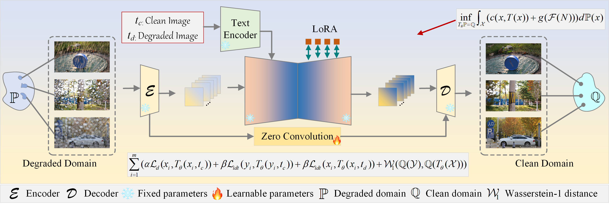

# SFTOT

**Structure-preserving Frequency-regularized Text-guided Optimal Transport for Unpaired Rain Streaks and Raindrops Removal**

SFTOT learns image restoration from unpaired degraded and clean images. A one-step SD-Turbo backbone uses text prompts, LoRA adapters, and VAE skip connections to restore images, with structure-preserving transport and frequency-domain regularization.



## Installation


```bash
git clone https://github.com/chdwyb/SFTOT.git
cd SFTOT
conda create -n sftot python=3.10 -y
conda activate sftot
pip install torch==2.0.1 torchvision==0.15.2 --index-url https://download.pytorch.org/whl/cu117
pip install -r requirements.txt
```


xformers is optional and disabled by default. For the pinned PyTorch stack, install `xformers==0.0.20` and pass `--enable_xformers_memory_efficient_attention` to enable it.

## Data

Use the following layout (`A` = degraded, `B` = clean):

```text
data/my_dataset/
├── train_A/
├── train_B/
├── test_A/
└── test_B/
```

Alternatively, use `train/input`, `train/target`, `test/input`, and `test/target`. Layout detection is automatic.

The default prompts are `degraded image` and `clean image`. Set `--caption_src` / `--caption_tgt` to change them. Optional `fixed_prompt_a.txt` / `fixed_prompt_b.txt` files in the dataset root take precedence.

## Train

```bash
python train.py --config config.yaml --dataset_folder data/my_dataset --device cuda --output_dir outputs/sftot
```

Each run requires a fresh output directory. Generator checkpoints are saved as `checkpoints/model_<step>.pkl`; `checkpoints/training_latest.pt` also stores the discriminators, optimizers, schedulers, and random states. Resume into a new directory, using the total desired iteration count:

```bash
python train.py --config config.yaml --dataset_folder data/my_dataset --device cuda --resume_checkpoint outputs/sftot/checkpoints/training_latest.pt --max_train_steps 50000 --output_dir outputs/sftot_resume
```

Keep model ranks, losses, optimizer settings, and data consistent when resuming. The data loader starts a new shuffled epoch. Resuming from a generator-only `.pkl` requires `--allow_weights_only_resume` and the constant learning-rate schedule; it resets the discriminator/optimizer states.

## Test

Use a checkpoint produced by training. For degraded-to-clean restoration:

```bash
python inference_unpaired.py --input_dir data/my_dataset/test_A --checkpoint outputs/sftot/checkpoints/model_25000.pkl --direction a2b --prompt "clean image" --device cuda --output_dir outputs/test
```

For a single image, replace `--input_dir ...` with `--input_image path/to/image.png`. For reverse translation, use `--direction b2a --prompt "degraded image"`. Inference preserves image dimensions by default and requires width/height divisible by 8.


## Contact

Contact: [wyb@chd.edu.cn](mailto:wyb@chd.edu.cn).
